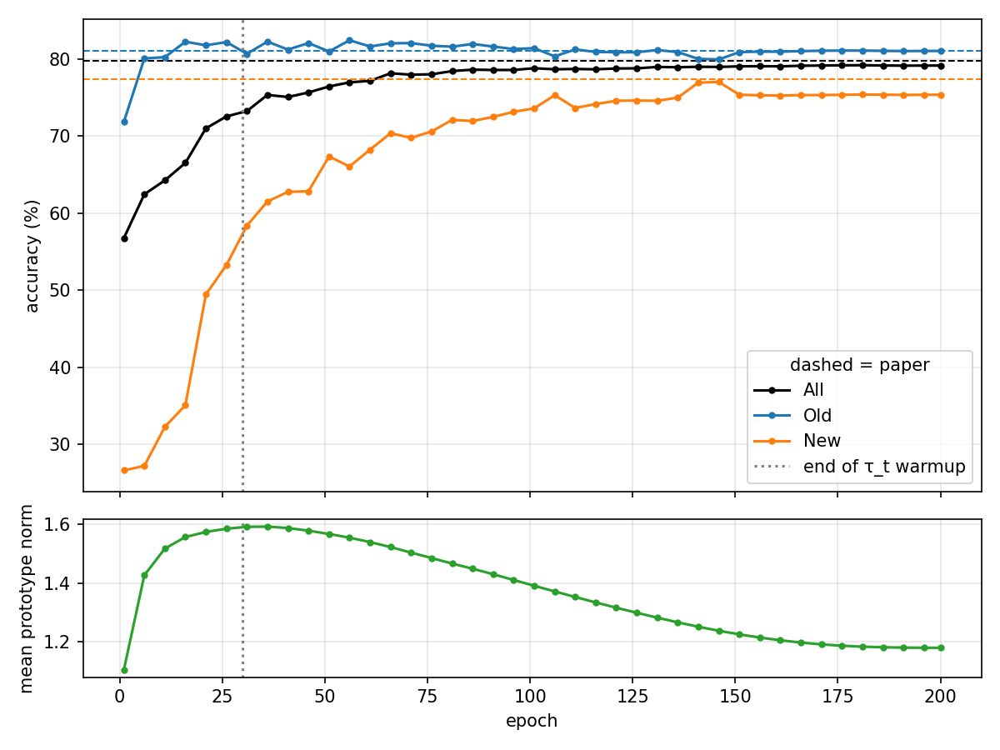
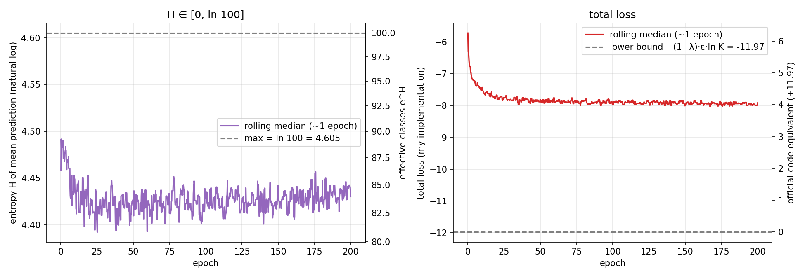

# SimGCD reimplementation in PyTorch


I reimplemented **SimGCD** ([Wen et al., ICCV 2023](https://arxiv.org/abs/2211.11727)), a method for
Generalized Category Discovery, from scratch in PyTorch. Over 3 seeds, it matches the paper's
CIFAR-100 results within the reported standard deviations. The [code walkthrough](docs/walkthrough.md)
documents every component with its tensor shapes, and can be read alongside the paper.

## Results

CIFAR-100, 80 old / 20 new classes, accuracy (%) on the unlabelled train set after the last epoch.

|                     | All            | Old            | New            |
|---------------------|----------------|----------------|----------------|
| Seed 42             | 79.14          | 81.03          | 75.35          |
| Seed 56             | 79.32          | 80.34          | 77.29          |
| Seed 7              | 79.52          | 81.53          | 75.49          |
| **Mean ± std**      | **79.3 ± 0.2** | **81.0 ± 0.6** | **76.0 ± 1.1** |
| [Official](https://github.com/CVMI-Lab/SimGCD) | 79.8 ± 0.6 | 81.1 ± 0.5 | 77.4 ± 2.5 |

All and Old fall within the official intervals. New is 1.4 pt lower, still within the official
standard deviation. Std is the sample std over the 3 seeds (`ddof=1`).





*Seed 42. Dashed lines are the paper's results. New accuracy keeps improving long after the end of
the teacher temperature warmup (dotted line).*

## Implementation highlights

- **The official `ColorJitter()` is a no-op.** It is called without arguments, and all torchvision
  defaults are 0, so no color augmentation is applied on CIFAR-100. I kept it to match the reported
  results. [Details](docs/differences.md#colorjitter-is-a-no-op)
- The paper and the code disagree on the contrastive temperatures: the paper gives τ_u = 0.07 and
  τ_c = 1.0, the code swaps them. I follow the code.
  [Details](docs/differences.md#temperature-mismatch-between-paper-and-code)
- Resuming a run is bit-exact on CPU. Checkpoints hold the trainable parameters, optimizer,
  scheduler, scaler and RNG states (103 MB, against ~350 MB for the ViT-B/16 weights alone), and the
  logs record the git commit and whether the working tree was dirty.
  [Details](docs/walkthrough.md#84-checkpoints-and-portability)
- I log data loading time against GPU compute time, which is how I picked the GPU and the number
  of workers. [Details](docs/walkthrough.md#85-throughput)
- I wrote the representation loss as one masked contrastive loss that follows the paper's formula,
  instead of reusing the generic SupCon code. [Details](docs/walkthrough.md#62-representation-loss)

The full list of differences with the official code is in [docs/differences.md](docs/differences.md).

## Repository structure

```text
config.py             base config and machine profiles (PROFILES)
data/cifar.py         CIFAR-100 splits and two-view wrapper
models/
  backbone.py         DINO ViT-B/16, last block finetuned
  head.py             projection MLP and prototype classifier
  model.py            backbone + head
losses/
  classification.py   self-distillation classification loss
  representation.py   supervised and unsupervised contrastive losses
util/utils.py         helpers
train.py              training loop, AMP, checkpointing, resume
evaluate.py           accuracy on All / Old / New
plot_run.py           plots from a run directory
tests/                pytest suite, one file per component
docs/                 code walkthrough and differences with the official code
results/              per-seed metrics and configs (seed42, seed56, seed7)
assets/               figures used in this README
```

## Installation

```bash
git clone https://github.com/gildas-ev/simgcd-reimplementation.git && cd simgcd-reimplementation
pip install -r requirements.txt
```

To run on a new machine, add an entry to the `PROFILES` dict in `config.py`. A profile overrides
the base config: paths, batch size, precision, number of workers... CIFAR-100 and the DINO weights
are downloaded automatically on the first run.

## Usage

Each training run writes to a timestamped directory, `runs/<run_dir>/`.

```bash
python train.py --profile vastai --seed 42                                       # train
python train.py --profile vastai --resume <run_dir> --seed 42                    # resume
python evaluate.py --checkpoint runs/<run_dir>/ckpt.pt --profile vastai --seed 42 # evaluate
python plot_run.py --run_dir runs/<run_dir>                                      # plot curves
```

`evaluate.py` needs the seed used for training, because the seed defines the labelled/unlabelled split.

Tests:

```bash
pytest -m "not slow"   # fast suite, as run by the CI (~1 min)
pytest                 # full suite, the 4 slow tests download CIFAR-100 and the DINO weights
```

## Pretrained checkpoints

One checkpoint per seed (`seed42.pt`, `seed56.pt`, `seed7.pt`) is available in
[Release v1.0](https://github.com/gildas-ev/simgcd-reimplementation/releases/tag/v1.0).

```bash
gh release download v1.0 -p "seed42.pt" -D checkpoints/
python evaluate.py --checkpoint checkpoints/seed42.pt --profile <your_profile> --seed 42
```

Per-seed metrics and configs are in [`results/`](results/).

## Compute and cost

I debugged on Kaggle (T4) and ran the final trainings on vast.ai with an RTX 3090.
A 200-epoch run takes about 8 hours and costs around €2.15. The three seeds cost €6.42 in total.

## Limitations

- Only CIFAR-100 has been evaluated.
- GPU runs are not bit-for-bit deterministic; resuming is bit-exact on CPU.

## Acknowledgements and citation

Based on the paper and the [official implementation](https://github.com/CVMI-Lab/SimGCD) of SimGCD.

```bibtex
@inproceedings{wen2023simgcd,
    author    = {Wen, Xin and Zhao, Bingchen and Qi, Xiaojuan},
    title     = {Parametric Classification for Generalized Category Discovery: A Baseline Study},
    booktitle = {Proceedings of the IEEE/CVF International Conference on Computer Vision (ICCV)},
    year      = {2023},
    pages     = {16590-16600}
}
```
