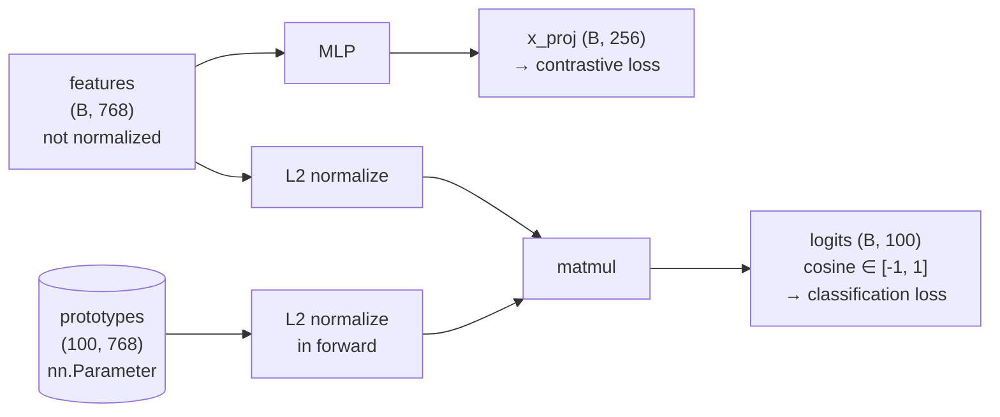

# Code walkthrough

Data flow, contracts and tensor shapes of every component, in the order the data goes through them.
Differences with the official implementation are listed in [differences.md](differences.md).

## 1. CIFAR-100 dataset split

| set | length | contents |
|---|---|---|
| `train_labelled` | 20 000 | classes 0–79 only |
| `train_unlabelled` | 30 000 | 20 000 from classes 0–79 + 10 000 from 80–99 |
| `train_unlabelled_eval` | 30 000 | same indices, test transform |
| `test` | 10 000 | all 100 classes |

The union of the two train sets is 50 000 images, and their intersection is empty.
This assumes `num_old_classes = 80` and `prop_train_labels = 0.5`.

I use two instances of the CIFAR100 dataset, one carrying the train transform and one carrying
the eval transform. Each split is a subset of one of those instances. `train_labelled` and
`train_unlabelled` are merged further down the pipeline by `WrapperCIFAR`. The chain is:

`DataLoader → sampler gives an index → WrapperCIFAR → Subset → the CIFAR100 instance carrying either the train or the eval transform`

## 2. Data loader

Batch contract:

```
train loader:
    ([Tensor(128,3,224,224), Tensor(128,3,224,224)],   # list of views
     Tensor(128,)  int64,                              # labels
     Tensor(128,)  bool)                               # mask

    torch.cat(images, dim=0) -> (256,3,224,224)
    view 0 = rows 0..127, view 1 = rows 128..255       # block-wise

eval loader:
    (Tensor(256,3,224,224),
     Tensor(256,) int64)
```

## 3. Backbone

The backbone is a pretrained DINO ViT-B/16.

Backbone contract:

```
input batch:
     Tensor(B,3,224,224) torch.float32

output features:
     Tensor(B,768) torch.float32
```

ViT-B/16 has 12 transformer blocks (0 to 11). As in the official implementation
(`grad_from_block=11`), only the last block is finetuned.

## 4. Head

Head contract:

```
input features:
     Tensor(B,768) torch.float32

outputs:
     Tensor(B,256) torch.float32, Tensor(B,100) torch.float32
```

The first output is the features projected through a three-layer MLP,
768 → 2048 → 2048 → 256, with GELU activations in between and no batchnorm, as in the original code.

The second output is the cosine similarity in [-1, 1] between each feature vector and each prototype.



## 5. Model

The `Model` class simply wraps the backbone and the head into one `torch.nn.Module`.

## 6. Losses

### 6.1 Classification loss

`loss_classification` implements the classification loss of Eq. (4) of the paper. It returns the
supervised and unsupervised classification losses, which are combined in the training loop.

```
inputs:
     Tensor(2B,100) torch.float32   raw cosine logits of the head; the first B rows are the
                                    first view, the last B rows the second view
     Tensor(B,) torch.int64         labels
     Tensor(B,) torch.bool          labelled mask
     tau_s, tau_t, epsilon          floats from the config

output:
     dict with keys 'L_cls_u', 'L_cls_s', 'logs'
```

The teacher logits are detached, so that at each step the student learns to predict the teacher
as a fixed target. The logged values are detached too, to avoid keeping each step's graph alive
and running out of memory.

### 6.2 Representation loss

`loss_representation` returns the supervised and unsupervised representation losses.

```
inputs:
     Tensor(2B,256) torch.float32   raw projected features of the head; the first B rows are the
                                    first view, the last B rows the second view
     Tensor(B,) torch.int64         labels
     Tensor(B,) torch.bool          labelled mask
     tau_u, tau_c                   floats from the config

output:
     dict with keys 'L_rep_u', 'L_rep_s'
```

I rewrote this loss in order to (1) stay close to its mathematical expression, (2) use a single
function for the supervised and unsupervised losses, and (3) avoid the generic SupCon code.

The core logic lives in `contrastive_loss`, which computes:

$$\mathcal{L} = \frac{1}{N}\sum_{i=1}^{N} -\frac{1}{|P(i)|}\sum_{p \in P(i)} \log \frac{\exp(z_i^\top z_p/\tau)}{\sum_{k \neq i}\exp(z_i^\top z_k/\tau)}, \qquad \|z_i\| = 1$$

The two losses only differ by their positive set $P(i)$:
- **unsupervised**: the other view of the same image;
- **supervised**: all labelled samples with the same label, in both views, excluding $i$ itself.

## 7. Evaluation

`evaluate(model, loader, num_old, device, amp_dtype, use_amp)` returns the All, Old and New accuracies.
As in the paper, I report the accuracies after the last training epoch, computed in one pass over
the whole `train_unlabelled_eval` set.

The All accuracy is weighted by the number of Old and New samples (2/3 and 1/3).

## 8. Training

### 8.1 Training loop

- The two views yielded by the data loader are concatenated on GPU, which allows asynchronous
  loading of the batch.
- The config accepts an extra `stop_after_epochs` argument: the schedulers (learning rate and
  teacher temperature) are computed with `num_epochs`, but training stops earlier. This is used
  for debugging.

### 8.2 Optimizer

- Weight decay is filtered on parameter dimension, which excludes LayerNorm weights and biases
  (`ndim == 1`).
- Weight decay is also applied to the prototypes. Since the logits only depend on their direction,
  the gradient is orthogonal to each prototype, and gradient steps alone can only increase its norm.
  Weight decay counterbalances this, and the norm converges (see the mean prototype norm curve in
  the [README](../README.md#results)).

### 8.3 Precision

The numerical precision is chosen automatically among `fp32`, `fp16` and `bf16` for portability.
With `fp16`, `torch.amp.GradScaler` prevents small gradients from being rounded to 0.

### 8.4 Checkpoints and portability

- RNG states are saved too, so that resuming gives the exact same results (bit-exact on CPU).
- The logs record the current git commit and whether the working tree was modified (`dirty`).

### 8.5 Throughput

Every `print_freq` iterations, I log `t_data`, the time spent waiting for the next batch, and
`t_compute`, the GPU computation time. This helps choose the infrastructure (GPU, number of
workers). Since CUDA is asynchronous, `torch.cuda.synchronize` is called before reading the timers.
